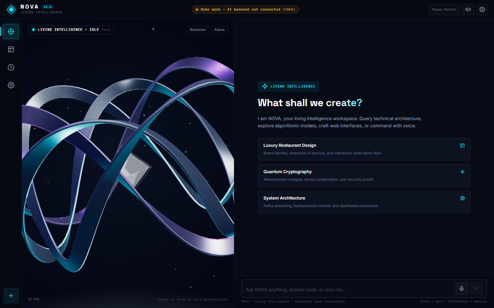
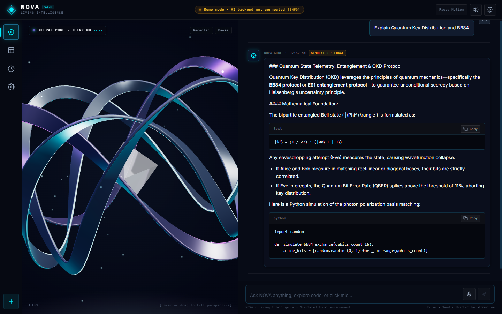
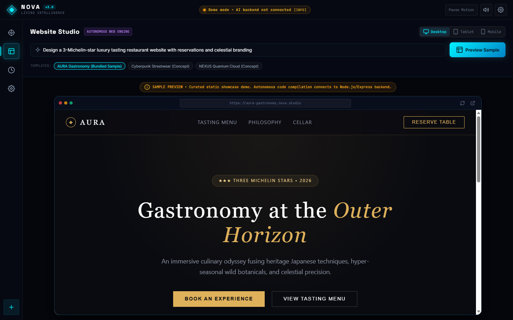
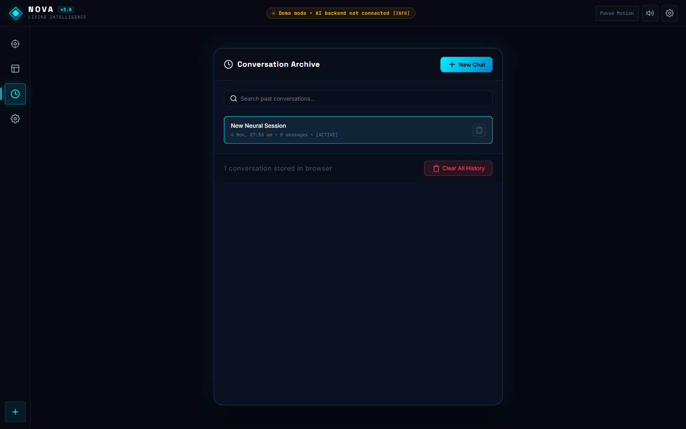
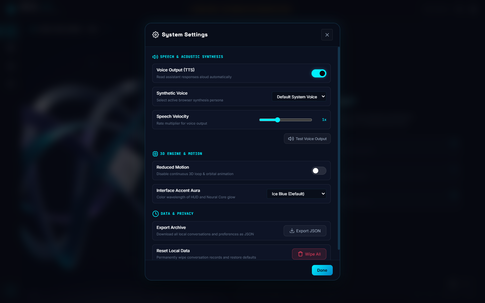
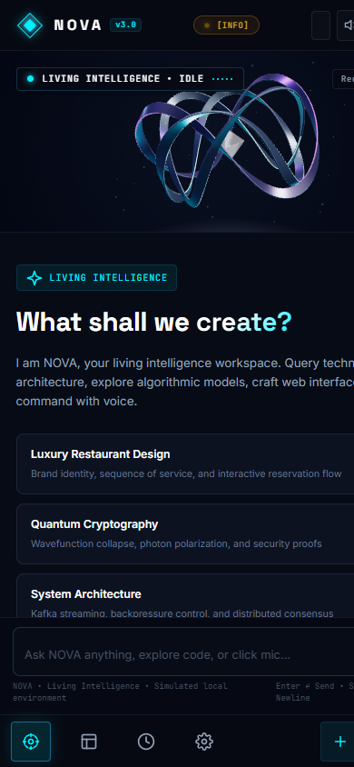

# NOVA — Living Intelligence
### Sculptural 3D AI Workspace & Digital Studio

NOVA is a premium, sculptural AI workspace frontend built with modern vanilla JavaScript, CSS custom properties, and Three.js running on Vite. Designed around the art direction **“NOVA — Living Intelligence”**, it replaces generic chatbot templates with an interwoven 3D sculpture centerpiece and an editorial conversation workspace.

---

## 📸 Verified Interface Views

| View | Preview |
|---|---|
| **Living Intelligence Workspace** |  |
| **Active Conversation & Thinking State** |  |
| **Website Studio (Sandboxed)** |  |
| **Conversation Archive** |  |
| **System Settings** |  |
| **Mobile Adaptive Layout** |  |

---

## 💎 Signature 3D Object: Living Intelligence

The centerpiece is a procedural Three.js sculpture engineered from mathematical spline manifolds:
- **Three Interwoven Twisted Ribbons:** Continuous 3D curves with visible thickness, 8-point chamfered bevels, and a smooth $1.5\times$ continuous twist.
- **Brushed Titanium Surfaces:** `MeshStandardMaterial` (`metalness: 0.88`, `roughness: 0.28`) reflecting procedural studio softboxes without external HDR dependencies.
- **Softly Illuminated Inner Edges:** Luminous inner edge conduits running along ribbons 1 & 2 in Electric Cyan (`#00f0ff`).
- **Restrained Violet Accent:** Ribbon 3 features a deep violet metallic sheen and an illuminated Amethyst/Violet inner edge (`#a855f7`).
- **Pearl-White Luminous Crystal:** A faceted gem suspended at the core (`#f8fafc`, `transmission: 0.65`, `ior: 1.52`) with an internal point light radiating soft light through its facets.
- **Diagonal Asymmetrical Silhouette:** Tilted at `(0.32, -0.28, 0.22)` for a recognizable, cinematic presence.
- **Faint Ground Halo & Drifting Dust Motes:** Additive ground glow and 42 drifting light particles gently orbiting and rising.
- **State Transitions:**
  - `Idle`: Gentle floating oscillation and organic ribbon breathing.
  - `Listening`: Soft light traveling dynamically along the inner conduits.
  - `Thinking`: Harmonized wave of motion and progressive ribbon illumination.
  - `Speaking`: Subtle pearl-white crystal pulses.
- **Hardware Fallback:** If WebGL is unavailable, NOVA seamlessly mounts an SVG/CSS hardware-accelerated replica of the interwoven ribbons and crystal.
- **Genuinely Measured FPS:** Only real frames measured across 1000ms intervals are displayed (no fake frequencies or invented metrics).

---

## 🏛️ Workspace Architecture & Layout

- **Asymmetric Desktop Composition:** ~45% left stage dedicated to the 3D sculpture, ~55% right dedicated to the high-legibility Conversation Studio.
- **Visible Navigation Dock:** Left rail with instant access to:
  1. `Assistant` (Main 3D workspace)
  2. `Website Studio` (Autonomous website sandbox)
  3. `History` (Conversation archive)
  4. `Settings` (Voice persona, motion, export)
- **Empty State Pathways:** Prominently asks **“What shall we create?”** with an introductory briefing and three starter prompt pathways that dispatch immediately upon click.
- **Spacious Anchored Composer:** Docked firmly below the conversation stream with auto-expanding textarea, microphone input, and instant send controls.
- **Clean Editorial Typography:** Sans-serif headings and body text (`Inter` & `Space Grotesk`) with monospace reserved exclusively for code blocks and technical metadata.
- **Robust Independent Mounting:** Navigation, chat, studio, and history modules initialize independently; any 3D failure degrades gracefully to the fallback without blanking the screen.
- **Mobile Responsive Layout:** Stacks cleanly with a compact 200px sculpture above the conversation, anchored composer, and a convenient bottom dock.

---

## 🚀 Quick Start & Run Commands

### Prerequisites
- Node.js (v18+ recommended)
- npm (v9+)

### Installation & Development
```bash
# 1. Install dependencies
npm install

# 2. Launch Vite development server
npm run dev
```

The application will be live at `http://localhost:5173/`.

### Production Build & Preview
```bash
# Build optimized production bundle
npm run build

# Preview the production build locally
npm run preview
```

---

## 🔍 Feature Matrix: Working vs. Simulated vs. Future Backend

| Feature | Implementation Status | Technical Details |
|---|---|---|
| **Living Intelligence 3D Object** | **Real 3D Engine** | Procedural Three.js scene, pointer parallax tilt, smooth state transitions (`Idle`, `Listening`, `Thinking`, `Speaking`), genuine FPS counter. |
| **Voice Input (STT)** | **Working Browser API** | Real Web Speech `SpeechRecognition`. Activated strictly when the mic button is clicked. Handles errors, unsupported browsers, and permission denial gracefully. |
| **Voice Output (TTS)** | **Working Browser API** | Real Web Speech `SpeechSynthesis`. Configurable voice persona, speed multiplier, mute toggle, and an active **Stop** speech button. |
| **Local Conversation History** | **Working Persistence** | Stored in `localStorage`. Full search filter, multi-session switching, individual deletion, and bulk "Clear All History" with safety confirmation. |
| **Website Studio** | **Working Sandbox** | Sandboxed `<iframe>` environment with desktop/tablet/mobile device switcher, reload action, and new-tab preview. |
| **Curated Website Template** | **Showcase Asset** | Bundled responsive luxury dining website (**"AURA — Gastronomy in Void"**) with Michelin accreditation and tasting menu cards. Explicitly labelled as a curated sample. |
| **AI Assistant Responses** | **Simulated Local** | Generated by `src/services/apiAdapter.js` using contextual knowledge and simulated token streaming. Every response carries a clear `SIMULATED • LOCAL` badge. |
| **Backend Integration** | **Drop-in Ready** | Pre-architected adapter ready to switch from demo mock data to a live Node.js/Express `POST /api/chat` endpoint. |

---

## 🔌 Connecting to a Live Node.js / Express Backend

Connecting a live LLM backend (Gemini, Claude, OpenAI, Ollama) requires changing only one configuration flag:

### 1. Backend Endpoint Expectation
Create an Express route (e.g. `POST /api/chat`):

```javascript
// server.js (Node.js / Express)
import express from 'express';
import cors from 'cors';

const app = express();
app.use(cors());
app.use(express.json());

app.post('/api/chat', async (req, res) => {
  const { prompt, history } = req.body;
  
  // Forward to your AI provider (e.g., Gemini API)
  // const reply = await callLlm(prompt, history);
  res.json({ reply: "Hello from live backend!" });
});

app.listen(5000, () => console.log('NOVA backend running on http://localhost:5000'));
```

### 2. Update Frontend Adapter
In `src/services/apiAdapter.js`:

```javascript
export class ApiAdapter {
  constructor() {
    this.isDemoMode = false; // <-- Switch from true to false
    this.backendEndpoint = 'http://localhost:5000/api/chat';
  }
}
```

---

## ♿ Accessibility & Ergonomics

- **Standard Focus Visibility:** All buttons, inputs, and links include `:focus-visible` cyan outline rings.
- **Keyboard Shortcuts:** `Enter` sends message; `Shift + Enter` creates a newline; `Esc` dismisses modals.
- **Reduced Motion:** Respects user's OS `prefers-reduced-motion` and provides a manual "Pause Motion" header toggle.
- **Speech Privacy:** Microphone is activated **strictly** when explicitly triggered by the user, and recognition auto-terminates after speech ends.
