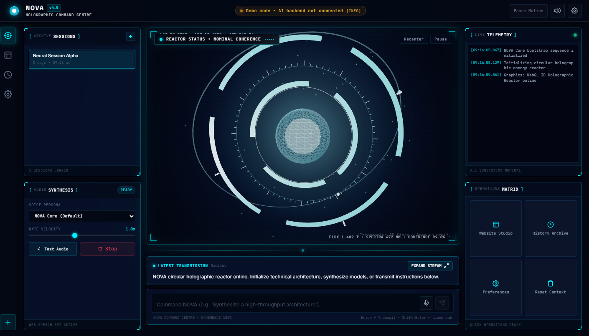
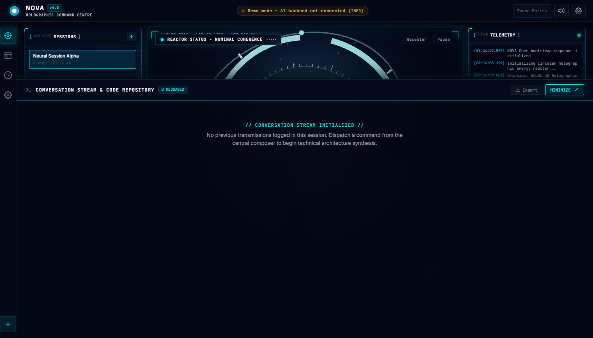
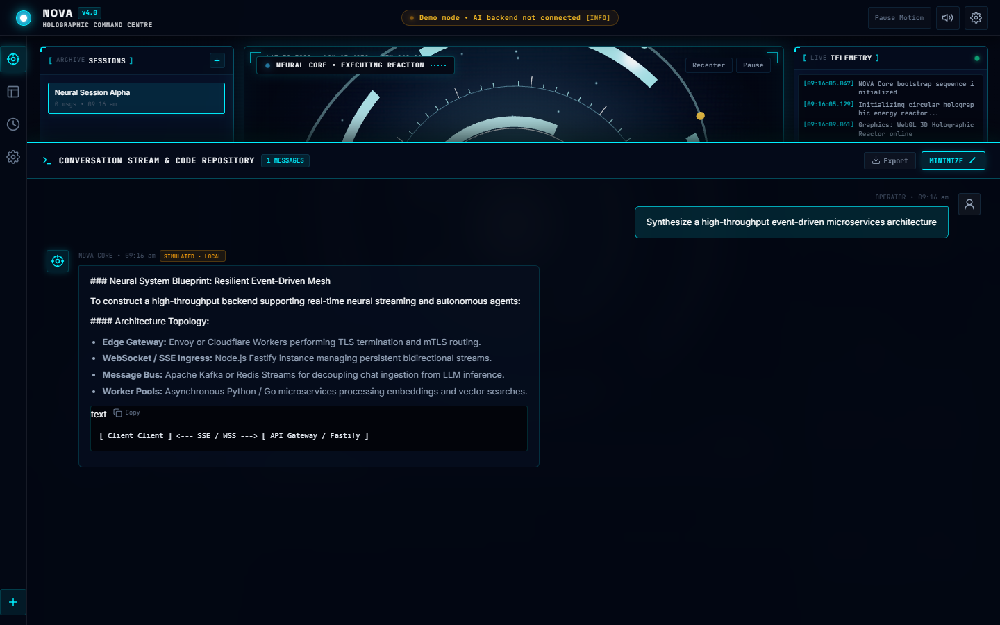
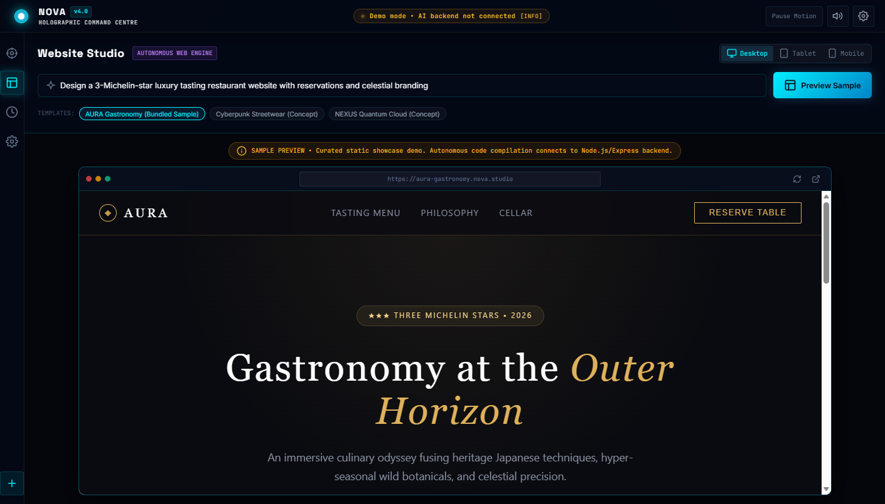
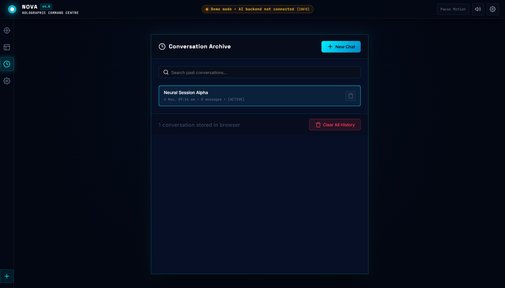
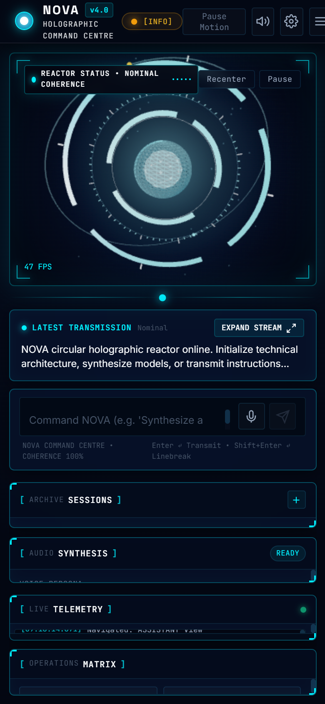

# NOVA — Holographic AI Command Centre
### Full-Screen Holographic AI Dashboard & Digital Studio

NOVA is a full-screen, cinematic blue holographic AI command centre built with modern vanilla JavaScript, Three.js, CSS custom properties, and Vite. Inspired by cinematic sci-fi monitor interfaces, it replaces standard conversational chat layouts with a large circular holographic energy reactor, balanced surrounding telemetry panels, an expandable stream drawer, and responsive command controls.

---

## 📸 Verified Interface Views

| View | Preview |
|---|---|
| **Holographic Command Centre (Desktop)** |  |
| **Expandable Stream & Code Repository** |  |
| **Live Command Dispatch & Formatted Code** |  |
| **Website Studio (Autonomous Sandbox)** |  |
| **Conversation Archive** |  |
| **Mobile Adaptive Command Centre** |  |

---

## ⚡ Central Holographic Energy Reactor

The focal point of NOVA is a layered circular energy reactor occupying ~45–55% of the desktop workspace height:
- **Central Energy Nucleus:** Multi-faceted icosahedron geometry inside a translucent glass sphere (`transmission: 0.72`, `roughness: 0.12`) with internal dual-color point lights.
- **Three Independently Rotating Segmented Rings:**
  - *Inner Ring:* High-speed fine segments with 6 radial cutouts.
  - *Mid Ring:* Counter-rotating segmented band with cardinal anchor markers.
  - *Outer Ring:* Primary calibration ring with arc segments and glowing neon rims.
- **72 Procedural Calibration Ticks:** Circumferential tick marks with major divisions every 6 units and cardinal indicators (`000°`, `090°`, `180°`, `270°`).
- **Tilted Orbital Assembly:** Elliptical 3D orbital plane with 3 traveling photon beacons orbiting with perspective depth (including an amber energy marker).
- **Sparse Ambient Motes & Ground Halo:** 32 subtle drifting particles and a radial ground illumination field.
- **Dynamic State Animations:**
  - `Idle`: Smooth, calm rotations with steady breathing core.
  - `Listening`: Expanded outer ring, faster orbital beacon, responsive audio waveform.
  - `Thinking`: Accelerated counter-rotations and active nucleus calculations.
  - `Speaking`: Harmonious wave pulses across rings and glowing energy bursts.
- **2D Vector Fallback Reactor:** If WebGL is unavailable or restricted by sandbox policies, NOVA automatically mounts an SVG/CSS vector replica with identical geometry, honestly marked as `FALLBACK ENGINE: 2D VECTOR REACTOR (WebGL restricted/unavailable)`.
- **Genuinely Measured FPS:** Only real frames measured across 1000ms intervals are displayed (`performance.now()`); no invented frequencies or fake measurements.

---

## 🏛️ Command Centre Layout & Surrounding Panels

The workspace uses a balanced 3-column holographic command grid with deep navy glass (`#020612`, `#040a18`) and electric cyan accents (`#00f0ff`, `#38bdf8`):

### 1. Left Operational Column (280px)
- **Panel 1 — Sessions Archive:** Real-time log of stored conversations from `localStorage`, timestamp, message count, active selection highlighting, and a quick "New Session" button.
- **Panel 2 — Acoustic Synthesis:** Live voice telemetry powered by the Web Speech API with persona selection, speech velocity slider (`0.7x – 1.4x`), diagnostic "Test Audio" synthesis, and a manual "Stop" button.

### 2. Center Command Column (Flex 1)
- **Holographic Reactor Stage:** Centered circular energy core (~45–55% workspace height) with reticle corner brackets, coordinate tags, audio waveform status pill, and camera controls.
- **Animated Holographic Connection Bus:** Dynamic data stream connecting the core to the transmission hub.
- **Latest Transmission Preview Capsule:** Displays a sleek live summary of the most recent response with timestamp and an **"EXPAND STREAM [↗]"** action.
- **Central Command Composer:** Bottom-anchored message composer with auto-growing textarea, voice input mic toggle, send trigger, and speech stop control.

### 3. Right Intelligence Column (280px)
- **Panel 3 — System Telemetry:** Live event stream capturing application bootstrap, graphics state changes, audio synthesis, memory events, and user queries with millisecond timestamps.
- **Panel 4 — Operations Matrix:** Fast-action grid offering one-click access to the Website Studio, History Archive, System Preferences, and Session Reset.

### 4. Expandable Conversation Drawer
- Keeps the default dashboard clean and focused on the reactor while allowing full access to long multi-turn conversations and large code repositories.
- Includes full markdown formatting, syntax code blocks with **"Copy"** buttons, text-to-speech replay, and JSON export.
- Minimizes smoothly back to the holographic dashboard with a single click.

---

## 🚀 Quick Start & Run Commands

### Prerequisites
- Node.js (v18+ recommended)
- Modern web browser (Chrome, Edge, Firefox, Safari)

### Installation & Development
```bash
# Clone repository
git clone https://github.com/sohammridha3-collab/NOVA.git
cd NOVA

# Install dependencies
npm install

# Start local Vite development server
npm run dev
```

Open `http://localhost:5173/` in your browser.

### Automated Smoke Tests (Headless Browser)
Runs the automated test suite testing the 3D reactor, fallback vector engine, 4 surrounding panels, drawer, and simulated streaming chat:
```bash
npm run test:smoke
```

### Production Build
```bash
npm run build
npm run preview
```

---

## 🔌 Connecting to a Real Backend

By default, NOVA runs in **Demo Mode** using `src/services/apiAdapter.js` to simulate intelligent streaming responses locally with zero backend setup.

To connect a Node.js / Express or Python backend:
1. Open [src/services/apiAdapter.js](file:///c:/Users/Sayan%20Mridha/Desktop/NOVA/src/services/apiAdapter.js).
2. Set `isDemoMode = false` and specify your `endpoint` (e.g. `http://localhost:3000/api/chat`).
3. Ensure your server accepts `POST` requests and streams chunks or returns a JSON response:
   ```json
   {
     "message": "Assistant response text",
     "timestamp": "2026-11-04T09:00:00Z"
   }
   ```

---

## 🛡️ Resilience & Engineering Standards

- **Resilient Graphics Loading:** Essential UI (Navigation, Panels, Composer, Drawer) mounts before 3D initialization. If WebGL is unavailable, the 2D vector fallback takes over without ever presenting a blank screen.
- **Zero Hallucinated Numbers:** Frequencies and FPS readings reflect actual measured performance.
- **Full Offline Persistence:** Stored locally in `localStorage` with export capabilities.
- **Accessibility & Motion Preferences:** Honors `prefers-reduced-motion` and provides direct "Pause Motion" quick toggles.
- **Cross-Platform Responsive Design:** Seamlessly adapts from 4K ultrawide monitors down to 390px mobile screens.
